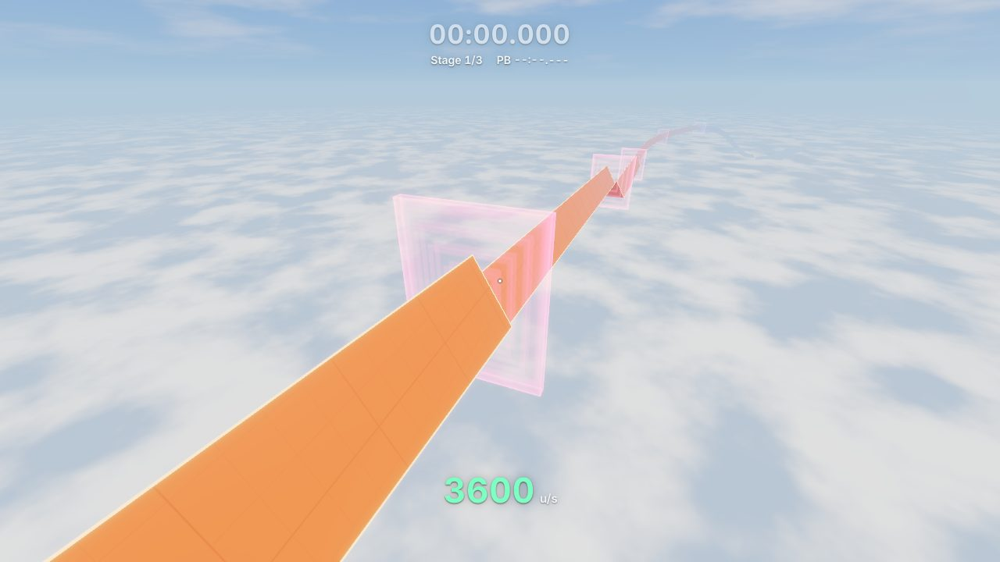
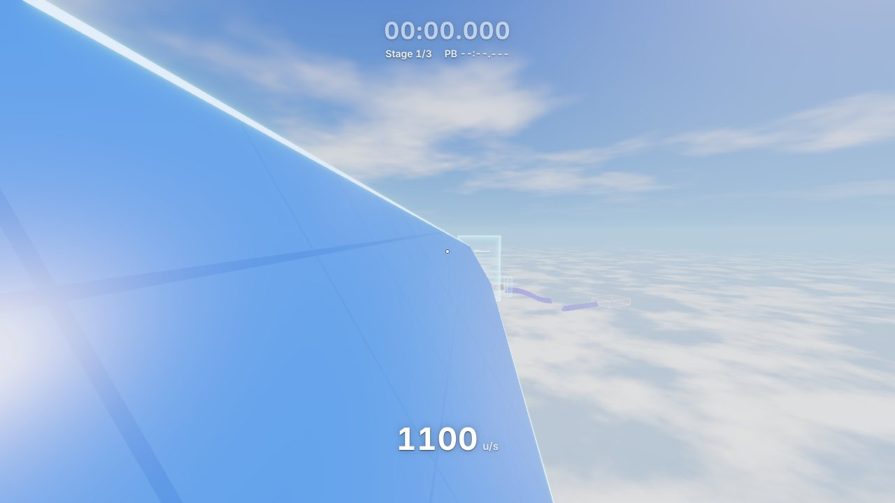
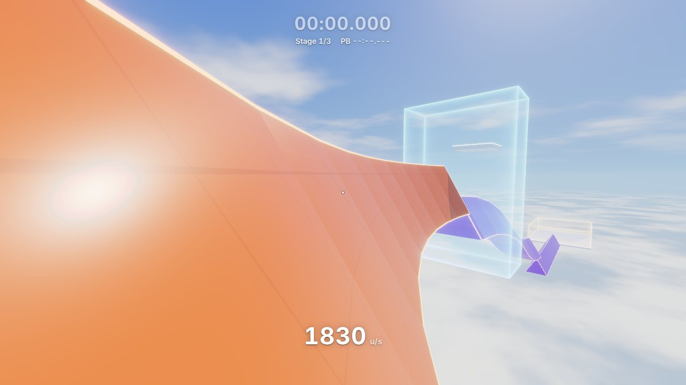
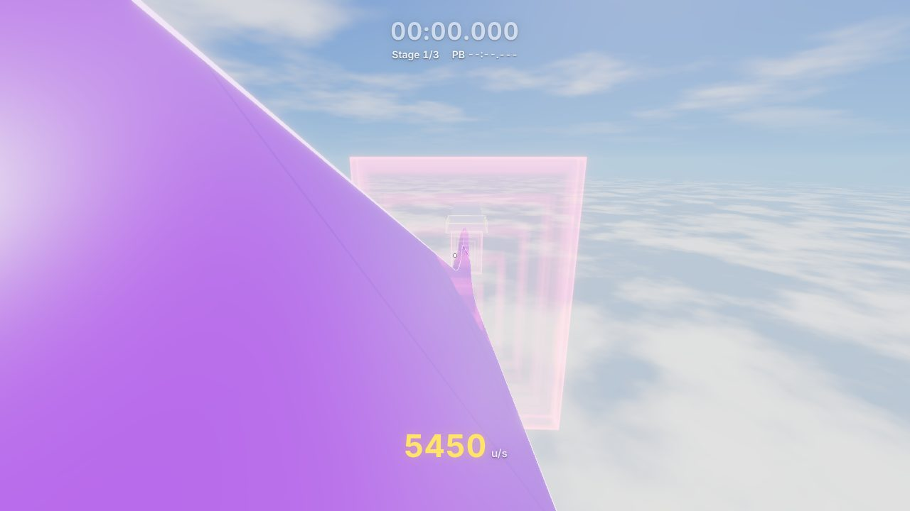
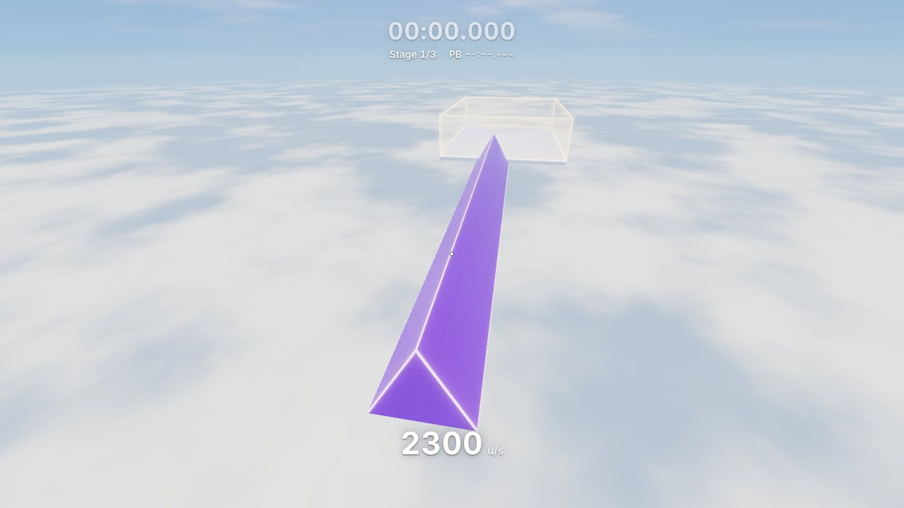
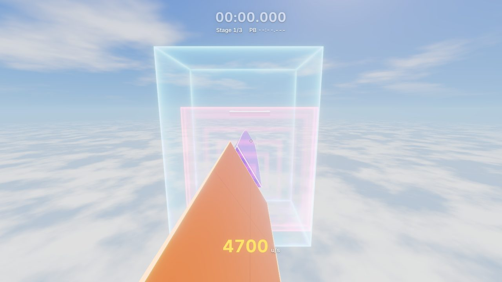
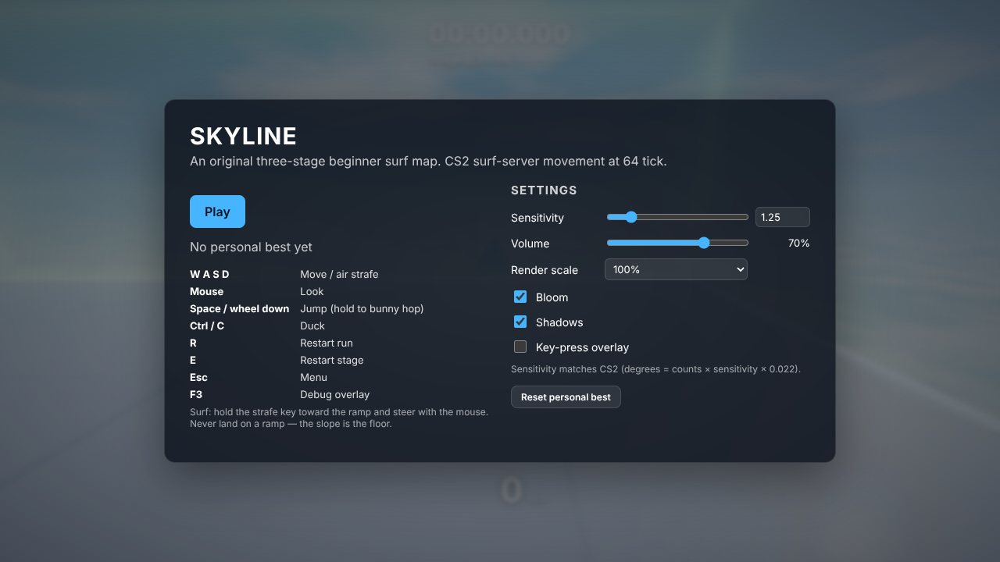

# Skyline Surf

A first-person surf game for the browser whose movement is a port of the
Counter-Strike movement code (`CGameMovement::FullWalkMove`) with CS2 defaults
and the usual surf-server overrides. It ships with **Skyline**, an original
three-stage map floating above a sea of clouds and built for speed: you are
launched at 2,000 u/s the moment you step off the start platform, boosters in
every gap and steeper and steeper ramps keep adding speed, and the speed cap is
raised from CS2's 3,500 to 10,000 u/s. A run finishes at over 7,000 u/s.

Movement and collision are written from scratch: there is no physics engine and
no character controller. Surfing is not a special state. A ramp steeper than the
ground limit is simply not ground, and gravity, velocity clipping and air
acceleration produce the surf on their own.



| | |
|---|---|
|  |  |
|  |  |
|  |  |

## Quick start

```sh
npm install
npm run dev        # open the printed URL, click Play
```

| Script | What it does |
|---|---|
| `npm run dev` | Vite dev server |
| `npm run build` | Strict typecheck, then production build into `dist/` |
| `npm run preview` | Serve the production build |
| `npm run typecheck` | `tsc --noEmit` (strict) |
| `npm test` | Vitest: physics proofs, map validation, timer, allocation checks |
| `npm run serve` | Serve `dist/` on localhost with `serve.mjs` and open the browser |

Add `?map=test` to the URL for the small gray-box test map.

### Windows (cmd)

With a prebuilt `dist/` (as in the release zip), the game needs only
[Node.js](https://nodejs.org). There is no install step:

```bat
cd path\to\skyline-surf
play.bat
```

`play.bat` serves `dist/` with `serve.mjs` (a zero-dependency static server
bound to localhost) and opens `http://localhost:8080`. If that port is taken it
picks the next free one and prints it. Keep the cmd window open while you play;
Ctrl+C stops it. If `dist/` is missing, `play.bat` runs `npm install` and
`npm run build` once first. `dev.bat` starts the Vite dev server instead
(it runs `npm install` on first use).

The stack is Vite, TypeScript (strict), Three.js r186, pmndrs `postprocessing`
6, Vitest, and plain DOM/CSS for the HUD. It needs a WebGL2 browser; Chromium
gets the full feature set (raw mouse input, Keyboard Lock).

## Controls

| Key | Action |
|---|---|
| W A S D | Move on the ground, air strafe in the air |
| Mouse | Look (raw input, CS2 sensitivity scale) |
| Space, or mouse wheel down | Jump. Hold to bunny hop (auto-bhop) |
| Ctrl or C | Duck |
| R | Restart the run (back to the start zone) |
| E | Restart the current stage |
| Esc | Menu (pauses) |
| F3 | Debug overlay |

Clicking **Play** captures the mouse with Pointer Lock (`unadjustedMovement:
true` for raw counts, with a fallback where unsupported), goes fullscreen, and
takes a Keyboard Lock so Ctrl+W, Ctrl+S and Ctrl+D reach the game instead of
the browser. Every game key also has its default suppressed.

**How to surf:** walk off the front of the start platform: the pink boost pad
launches you at 2,000 u/s onto the face of the ramp below. Hold the strafe key
that pushes you *into* the ramp (A on a right-hand face, D on a left-hand face)
and steer with the mouse. Holding into a 60° face cancels the slide down it (and
even climbs slowly). Fly through the pink boost gates in the gaps for more
speed. Air strafing works as in CS: hold A or D and turn the mouse the same way.

## How the movement works

All gameplay math is in Hammer units, +Y up. The player is an axis-aligned box,
32 × 32 × 72 (54 ducked), with its origin at the feet; the eye is 64 above the
feet (46 ducked). A surface is ground only if its normal's up component is
≥ 0.7. That one rule is what makes surfing exist.

Every tick (64 Hz, `src/physics/movement.ts`, `PlayerController.tick`):

1. `wishdir` = WASD projected on the horizontal plane using view yaw only,
   normalized. With any key down, `wishspeed` = 250 (× 0.34 ducked).
2. Apply half of `gravity × dt` to the vertical velocity.
3. If grounded and jump is held: vertical velocity = 301.993 and leave the
   ground. This runs before friction, so bunny hops keep their speed.
4. Grounded: friction, ground accelerate, then `WalkMove` (a step/slide move
   plus `StayOnGround`). Airborne: air accelerate, then slide move.
5. Re-check ground: trace the hull 2 units down. The player is grounded only if
   that hits a plane with up-normal ≥ 0.7 while vertical velocity ≤ 140.
6. Apply the other half of gravity; if grounded, zero the vertical velocity.
7. Clamp each velocity axis to ±10,000 (`sv_maxvelocity`; CS2 uses 3,500,
   raised here so speed can keep building).

- **Friction:** `drop = max(speed, stopspeed) × friction × dt`, then scale the
  velocity by `max(speed − drop, 0) / speed`.
- **Ground accelerate:** `add = wishspeed − v·wishdir`; if positive,
  `v += wishdir × min(accelerate × dt × wishspeed, add)`.
- **Air accelerate:** `add = min(wishspeed, 30) − v·wishdir`; if positive,
  `v += wishdir × min(airaccelerate × wishspeed × dt, add)`. The 30 cap applies
  only to `add`; the acceleration term uses the full 250. This asymmetry is the
  whole mechanic and is deliberately preserved.
- **Slide move (`TryPlayerMove`):** up to 4 bumps. Trace the hull along
  `v × timeLeft`, advance to the hit, and clip the velocity against the hit
  plane. With two planes, slide along their crease (cross product). If the
  result opposes the original direction, stop. This also covers Source's
  first-impact-in-air clip and the "all fractions zero → stop" rule.
- **`StepMove`** (step up to 18 units), **`StayOnGround`**, and ducking (in the
  air the feet tuck up so the eye stays put; on the ground the eye eases down)
  are ported as well.

### Collision

- The world is **convex brushes**. Every primitive (box, A-frame prism,
  convex-from-points) becomes a point cloud, from which `brushFromPoints`
  (`src/physics/brush.ts`) builds face planes and convex face polygons.
- **Bevel planes** are added the way Quake 3's BSP compiler does: the axial
  planes, plus planes through each non-axial edge crossed with each axis, kept
  when the brush lies behind them. With these, "offset every plane by the box
  support" is an *exact* Minkowski sum of the brush and the player box, so the
  hull never catches on phantom corners beyond a brush's real edges.
- **Swept-AABB trace** (`CollisionWorld.traceBox`, `src/physics/world.ts`) ports
  `CM_ClipBoxToBrush`: offset each plane by the hull's support, clip the segment,
  and report fraction, hit normal, `startSolid` and `allSolid`.
- **Broadphase:** a BVH over brush bounds, traversed with a preallocated stack.
- The hull is kept **0.03125 units** (`DIST_EPSILON`) off whatever it hits.
- Render meshes are generated from the **same brushes** (`src/render/meshes.ts`),
  so visuals and collision always match.

### Ramp bugs

Crossing a seam between adjacent ramp brushes never costs speed. Four things
make that true:

1. **Exact entry test.** Source inflates every plane by epsilon *before*
   deciding whether the sweep enters a brush. Offsetting planes is not a true
   offset of a polytope: at convex edges the inflated planes meet in sharp
   corners that bulge past the brush, and a hull riding a face at exactly
   epsilon sits inside the bulge of the next segment's end cap and gets
   stopped. This is the classic seam ramp bug. Here the entry is decided
   exactly (Cyrus–Beck against the exact Minkowski sum), and only then is the
   stop point backed off epsilon along the entry plane.
2. **The specified fix.** If a move is blocked at fraction 0 by a plane that the
   velocity is already parallel to or leaving (`v·n ≥ −1e-4·|v|`), nudge out
   0.03125 along the normal and retry instead of clipping.
3. **No duplicate planes.** A plane within 0.26° of one already clipped this
   move is never added to the list again (Quake 3 does the same), because two
   near-identical planes would produce a zero-length crease and stop the
   player.
4. **Lifted retrace** for misaligned brushes (Hammer-style 0.004-unit offsets
   leave real sub-epsilon ledges at seams). When blocked by a plane other than
   the one being ridden, the move is retraced from 0.2 units off the ridden
   surface and that path is used if it gets farther. Momentum-mod style ramp
   fixes do something similar.

A safety net, `unstick`, pushes the hull out of any brush it is found inside,
along that brush's shallowest plane.

### Proofs (Vitest, headless, `src/physics`)

| Test | Result |
|---|---|
| Air strafe: 250 u/s, gravity off, hold D while yawing right at 120°/s for 2 s | speed rises every tick and never drops; W alone gains exactly nothing |
| Slide: no input on an exact 60° ramp, from the ridge to the base | never grounded; Δspeed² is within 2% of 2·g·Δh (it actually matches to 0.0014%, because the half-step gravity is a leapfrog integrator) |
| Surf: mid-face at 800 u/s, strafe into the ramp, view parallel, 5 s | in contact every tick, never grounded, never sinks, along-ramp speed within 1% (exactly 800) |
| Seams: 1,000+ crossings at 500–3000 u/s on split ramps (random yaw, descent, lengths; half with misaligned brushes) | no tick loses ≥ 1% speed |
| Bhop: hold jump across flat ground at 600 u/s | horizontal speed never drops below 600 |

Extra suites go further. `seams.stress.test.ts` runs 6,000+ crossings over
several seeds, 1,500 more at **3,000–9,500 u/s** on split ramps descending up
to 20° (segments as short as 20 units, so several seams a tick), and curved
ramps with 2–8° joints, where the worst energy-equivalent loss is the geometric
cost of the turn. No tick loses 1% at any speed. `trace.test.ts` covers
brushes, traces, bevels, steps, ducking and jump height. `movement.test.ts`
also checks the ±10,000 clamp. `alloc.test.ts` is described under Performance.

## The map: Skyline

The map is data (`src/map/beginner.ts`): a list of primitives, trigger volumes
and stage spawns, assembled with small builders (`src/map/builders.ts`). Every
dimension that shapes a gap lives in `LAYOUT`. Ramps are A-frames 512 wide and
448 tall (faces 60.3° from horizontal). The course is about 112,000 units of
path and drops about 14,700 units from the start platform to the end runway.

- **Stage 1, blue.** A spawn platform inside the start zone floats over the
  first ramp. Its launch pad sends you onto that ramp at 2,000 u/s. The ramp is
  9,000 long, the extra-long one, and descends 7°; a gap with a boost gate leads
  to a second 7° ramp, 7,000 long.
- **Stage 2, orange.** A boost gate into the stage, a 7,000 ramp, then four
  8,000 ramps that alternate right and left faces (left-face ramps sit 256 units
  to the side, so the same lane lands on the facing side), each gap with a boost
  gate. The last one leads straight into a long, level right-hand curve: 26° of
  turn on a 44,000 radius in thirteen 2° segments, ridden on its inner face,
  with a booster halfway round.
- **Stage 3, violet.** A boost gate into the stage and the big drop: ten
  segments steepening from 2° to 20°, a 5,000-long straight at 20° with a
  booster halfway down, and seven segments flattening back to 6°. Then a
  2,500-unit air gap through the biggest boost gate (+800) to an 8,000 landing
  ramp, and a 16,000-long end runway with the end zone over its start.

### Boosters

Boosters are `boost` triggers, handled in `Game.boost`. Like a surf map's
`trigger_push`, but applied once, on entry: the velocity along the booster's
heading becomes `max(along + add, min)`, sideways and vertical velocity are
kept, and an optional `up` raises the vertical velocity to at least that,
lifting the player off the ground. Entry uses the same swept-hull test as the
checkpoints, so a gate thinner than one tick of travel (156 units at
10,000 u/s) still fires. A booster that would change nothing is silent.

- **Launchers.** Every spawn platform has a launch strip along its front edge,
  drawn as a pink chevron pad. Step off it and your along-course speed jumps to
  2,000 (the start), 2,600 (stage 2) or 3,600 (stage 3), with a 160 u/s lift so
  the platform's friction never bites. A hidden volume under each platform does
  the same if you step off a side or the back. Stage respawns are at zero
  velocity, as specified, and get going at once. Riders arriving from the
  previous stage are already faster and pass through untouched.
- **Gap gates.** A thin gate in every gap: +350 in stage 1, +250 into stage 2,
  +150 in each alternation gap, +400 into stage 3 and +800 across the long gap.
- **Face boosters.** +300 halfway round the curve and +600 halfway down the
  steep straight.

### Designing for speed

- **A downhill chain.** Every ramp descends, and after a gap the next ramp
  starts a `dip` below the line the previous ridge descends along. A rider
  leaves a ramp travelling along that line and falls away from it only by
  gravity, ½·g·(gap / speed)², so one gap works at any speed: the dip covers
  slow riders, and fast ones land a little further along. That is why every gap
  holds from half to twice the bot's speed.
- **Alternation needs deep dips and long ramps.** When the next ramp is ridden
  on the opposite face, the two faces slope opposite ways, so the clearance over
  the next ramp's start differs by 3.5× the spread of riding lines. The 420 dip
  clears riders down to 230 units from the ridge. The ramps are 8,000 long so
  riders near the ridge, who must fall furthest, still land on them at speed.
- **A curve has a speed limit.** Its inner face holds a rider only while
  v²/R ≤ g·tan 60° ≈ 1,386 u/s². Faster than that and the face pushes the
  rider up and over the ridge. The 44,000 radius holds about 7,800 u/s, 1.7×
  the bot's speed there.
- **Convex drops are flown over at speed.** A rider stays on a convex profile
  only while its curvature is below g/v² (4.4e-5 per unit at 4,300 u/s). The
  big drop steepens 2° every 1,100 units, close to that, so at stage 3 speeds
  riders skim just above it and touch down on the steep straight.
- **Concave joints push riders outward.** Each joint of a flattening profile
  clips the velocity against a face tilted further back, which nudges the rider
  down the face, more the faster they go. So the flattening comes before the
  long gap, at about 5,500 u/s, and the final landing ramp is one straight
  ramp: no joints at top speed.
- **The end runway is 16,000 long**, so even a finish at twice the bot's speed
  lands and stops on it.

**Triggers.** A start zone, a fly-through checkpoint gate at the start of
stages 2 and 3, an end zone, the boosters, and fail volumes: a sloped volume
under every ramp and the gap leading to it (so a fall is short wherever it
happens), plus a catch-all under everything. A fail teleports to the current
stage's start with zero velocity. Each stage start is a small pad floating just
above the incoming flight band, so it never blocks the line.

**Validation.** `tests/map.test.ts` plays the map headlessly with the real
physics. A deliberately unskilled bot (`tests/bot.ts`) looks down each ramp and
holds the strafe key into its face, with no air-strafe gains.

- The bot finishes in **27.9 s** (checkpoints at 6.8 s and 22.1 s) without
  failing and without ever landing mid-run. It reaches stage 2 at about
  2,950 u/s and stage 3 at about 4,700, and finishes at over 7,000, with a top
  speed of 7,225 u/s. The same run in the browser, driven by the same bot
  through the real app, finishes in 27.870 s.
- Stages 2 and 3 are completable starting from their pads at zero velocity.
- **Every gap** lands cleanly with the exit velocity scaled from **0.5× to
  2×** the bot's (the whole vector, so the rider stays on the same line; bot
  exit speeds 2,340–7,250 u/s), on three riding lines (50, 120 and 200 units
  from the ridge). Lines 30 and 230 hold too.
- **The curve** holds riders on all three lines from 0.6× to 1.6× the bot's
  speed (1.8× also holds).

## Rendering

- **Sky:** a procedural shader (`src/render/sky.ts`) with a zenith-to-horizon
  gradient, an HDR sun disc that blooms, a soft FBM cloud layer, and a sea of
  clouds far below the course. It is baked once into a cubemap and PMREM for
  **sky-derived environment lighting**.
- **Fog** is FogExp2, but Three's fog chunks are replaced so fog uses radial
  distance and takes its colour from the sky in the view direction: the horizon
  and distant ramps always match.
- **Surfaces:** `MeshPhysicalMaterial` (light clearcoat) in one bold colour per
  stage, with an antialiased **world-space grid** (128-unit minor lines,
  512-unit major lines) projected on each face's dominant plane so speed is
  readable. The minor lines fade out between 2,600 and 4,800 u/s: lines
  128 units apart passing more than half a spacing per frame would strobe.
- **Emissive trim** along ridges, ramp lips and platform edges. The trim bands
  are cut out of the faces (a coplanar partition, not an overlay), so they can
  never z-fight. They are HDR, so bloom picks them up.
- **Zones** are translucent, additive, glowing boxes (green start, cyan
  checkpoint, gold end) that fade near the camera, so standing inside one tints
  the view instead of whiting it out.
- **Boosters** are hot pink. On the faces you fly through, rings sweep in toward
  the middle; on the other faces, chevrons stream in the push direction. Launch
  strips are drawn as chevron pads painted on the spawn platforms (alpha
  blended, so they stay crisp on the white platforms).
- **Lighting:** one sun with shadows (2048² map covering ±3,000 units) that
  follow the player, leading them by 0.3 s of travel (up to 1,800 units) so at
  speed they cover what is coming up. The focus is snapped to shadow texels and
  the map re-renders only when the snapped focus moves (the world is static);
  hemisphere fill; IBL.
- **Post:** an HDR (half-float) buffer with 4× MSAA (SMAA where MSAA is
  unavailable), then bloom, then ACES filmic tone mapping.
- **Depth:** a logarithmic depth buffer for the 100,000-unit far plane.
- **Camera:** a fixed vertical FOV of 73.74°, i.e. CS2's 90° horizontal at 4:3,
  Hor+. There is no view bob, sway, roll, camera lag, FOV kick or motion blur.

## Audio

Everything is synthesized with Web Audio (`src/audio/audio.ts`), with no asset
files. Wind is looping pink noise through a band-pass filter whose gain and
centre frequency follow horizontal speed, plus a high "whistle" layer at speed.
Both keep rising, on saturating curves, all the way to 10,000 u/s. There is a
landing thud scaled by impact speed, a rising whoosh through every booster, a
start blip, a two-note checkpoint chime, and a finish arpeggio (brighter on a
personal best), all through a light echo and a compressor.

## HUD and settings

- **HUD:** a bottom-centre speedometer (integer horizontal u/s) that changes
  colour at 1,500, 3,000, 4,500, 6,000 and 7,500 u/s and pulses when a booster
  fires; a run timer (`mm:ss.mmm`) that starts when the hull leaves the start
  zone and stops when it touches the end zone, both at sub-tick precision from a
  swept-hull test; the stage indicator; the personal best; split messages with
  ± deltas against the PB's splits; the run's top speed on the finish message;
  a static crosshair; and an optional key-press overlay.
- **F3 overlay:** fps, frame time, tick time, position, velocity (horizontal and
  3D speed), grounded and ducked flags, last hit normal (and whether it was
  touched this tick), stage and run phase.
- **Settings** (persisted in `localStorage`): sensitivity, volume, render scale
  (50–125%), bloom, shadows, key overlay, and a PB reset. The PB and its splits
  are stored per map id; the speed version of Skyline has a new id
  (`skyline-v2`), so times from the old course don't carry over.

## Performance

- **Zero allocations in the tick and trace hot paths.** The tick and trace code
  never creates objects, arrays, closures or strings; scratch vectors are
  preallocated. V8 also allocates a boxed number when a double is written to a
  field it treats as "tagged", or passed across a call it chose not to inline,
  so:
  - every numeric class field has a numeric initializer (class-field semantics
    would otherwise first define it as `undefined`);
  - the hot movement code does its vector math inline instead of calling
    helpers that take or return doubles;
  - `src/physics/alloc.test.ts` surfs for 1,000,000 ticks across seams, and
    traces 1,000,000 boxes, and requires that **no garbage collection** runs.
- **JIT warm-up.** Before Play is enabled, about 20,000 scripted ticks
  (walking off every spawn pad through its launcher, jumping, ducking, surfing,
  respawning) run on the real `Game` with its hooks muted, so V8 has optimized
  every movement path before the run. This
  is the CPU counterpart of precompiling shaders. Afterwards only rare cold
  paths (respawn, the seam retrace) show any boxing, averaging about 3 bytes per
  tick.
- **Shaders are precompiled** (`compileAsync`, plus one warm-up frame through
  every pass, shadows included) while the menu says "Loading". Toggling
  shadows recompiles at once, while you're still in the menu.
- **Static geometry is merged per material:** 4 surface meshes and 4 trim
  meshes. A frame is about 45 draw calls including the 17 zone and booster
  volumes and the shadow and post passes, and about 3k triangles. The sky is
  drawn after opaque geometry with a depth test, so its noise shader only runs
  on pixels that are actually sky.
- **Triggers** (57 of them: fail volumes, zones, boosters) are first tested
  against the bounds of the hull swept over the tick, which rejects almost all
  of them with six comparisons. The full trigger pass costs about 0.8 µs.
- **Cost:** a simulation tick takes about 2.6 µs in Node with the validation
  bot driving it, triggers included. The HUD writes to the DOM only when a
  value changes. The F3 overlay refreshes at 10 Hz.

## Tunables

### Movement: `src/physics/config.ts` (`DEFAULT_MOVEMENT`)

| Name | Default | Meaning |
|---|---|---|
| `tickrate` | 64 | Simulation rate (Hz) |
| `gravity` | 800 | sv_gravity (u/s²) |
| `maxSpeed` | 250 | Wish speed |
| `accelerate` | 5.5 | sv_accelerate |
| `friction` | 5.2 | sv_friction |
| `stopSpeed` | 80 | sv_stopspeed |
| `airAccelerate` | 150 | sv_airaccelerate (surf) |
| `airSpeedCap` | 30 | Cap on the air `add` term only |
| `jumpVelocity` | 301.993 | Jump impulse, sqrt(2·800·57) |
| `maxVelocity` | 10000 | Per-axis clamp (CS2: 3500) |
| `stepHeight` | 18 | Max step |
| `duckSpeedMultiplier` | 0.34 | Wish speed multiplier while ducked |
| `autoBhop` | true | Holding jump re-jumps on landing |
| `groundNormalMinY` | 0.7 | Minimum up-normal for ground |
| `nonJumpVelocity` | 140 | Rising faster than this is never grounded |
| `groundTraceDistance` | 2 | Ground check trace length |
| `distEpsilon` | 0.03125 | Hull clearance from surfaces |
| `hullHalfWidth` / `hullHeight` / `duckHullHeight` | 16 / 72 / 54 | Player box |
| `eyeHeight` / `duckEyeHeight` | 64 / 46 | Eye above the feet |
| `duckViewSpeed` | 144 | Eye easing speed when ducking on the ground (u/s) |
| `maxBumps` / `maxClipPlanes` | 4 / 5 | TryPlayerMove limits |

There is no stamina and no fall damage.

Ramp-fix constants live at the top of `src/physics/movement.ts`:

| Name | Default | Meaning |
|---|---|---|
| `PARALLEL_TOLERANCE` | 1e-4 | "Already parallel" threshold, relative to speed |
| `SAME_PLANE_DOT` | 0.99999 | Normals closer than this count as one plane |
| `NUDGE_DISTANCE` | 0.03125 | Push-off distance after a spurious block |
| `MAX_NUDGES` | 3 | Nudges allowed per move |
| `RETRACE_LIFT` | 0.2 | Lift off the ridden plane for the retrace |
| `MAX_RETRACES` | 2 | Retraces allowed per move |

### Client: `src/config.ts` (`CLIENT`)

| Name | Default | Meaning |
|---|---|---|
| `fovVertical` | 73.74° | CS2 90° horizontal at 4:3, Hor+ |
| `near` / `far` | 2 / 100,000 | Clip planes |
| `yawDegreesPerCount` / `pitchDegreesPerCount` | 0.022 | m_yaw / m_pitch |
| `maxPitch` | 89° | Pitch clamp |
| `maxFrameTime` | 0.25 s | Accumulator clamp |
| `defaults` | sens 1.25, volume 0.7, bloom on, shadows on, scale 100%, key overlay off | Initial settings |

### Look: `src/render/palette.ts` (`PALETTE`) and renderer constants

| Name | Default | Meaning |
|---|---|---|
| `surfaces.stage1/2/3/platform` | #2a86ff / #ff7426 / #a457ff / #dfe5ee | Stage colours |
| `trims.*`, `trimIntensity` | lighter tints, × 3.4 | Emissive trims (HDR) |
| `sky.zenith/horizon/haze/sun` | #125ad4 / #9ccbf6 / #b2cdea / #fff2dc | Sky and fog colours |
| `sunIntensity`, `hemisphereIntensity`, `envIntensity` | 2.9, 0.38, 0.5 | Lighting |
| `exposure` | 0.92 | ACES exposure |
| `fogDensity` | 1/34,000 | FogExp2 density |
| `cloudFloor` | −4,000 | Height of the sea of clouds |
| `TRIM_WIDTH` (`meshes.ts`) | 7 | Trim band width |
| `GRID_MINOR` / `GRID_MAJOR` (`materials.ts`) | 128 / 512 | Grid spacing |
| `SHADOW_EXTENT`, `SHADOW_MAP_SIZE`, `SHADOW_DISTANCE` (`renderer.ts`) | 3,000, 2,048, 9,000 | Shadow coverage |
| `SHADOW_LEAD_TIME`, `SHADOW_LEAD_MAX` (`renderer.ts`) | 0.3 s, 1,800 | How far the shadow focus leads the player |
| `GRID_FADE_START`, `GRID_FADE_END` (`renderer.ts`) | 2,600, 4,800 u/s | Minor grid lines fade out between these speeds |
| Bloom (`renderer.ts`) | threshold 1.05, smoothing 0.25, intensity 0.85, radius 0.72 | Bloom on HDR emissives |

### Map: `src/map/beginner.ts` (`LAYOUT`)

Ramp height and half-width (448 / 256), the alternation offset (256), the
first ridge's position, and per stage: ramp lengths and slopes; every gap's
length, `dip` and boost; the launch speeds (2,000 / 2,600 / 3,600); the curve
(radius 44,000, −26° in 13 segments, booster +300); the big drop's segment
slopes (2°→20° every 1,100), the steep straight (5,000 at 20°, booster +600),
the flattening (18°→6° every 900); the long gap (2,500, dip 330, boost +800);
the landing ramp (8,000 at 6°); the end runway (520 below, 16,000 long, end
zone over the first 3,000); and the pad clearance (100). Change anything there
and `npm test` re-validates every gap and the curve with the bot.

## Decisions made

- **Speed comes from the map, not from changed movement.** Asked for much more
  starting speed, much faster build-up and a much higher top speed, the game
  keeps every CS2 movement constant except `sv_maxvelocity`, raised from 3,500
  to 10,000 per axis. Gravity, air acceleration and the 30 u/s air cap are what
  make surfing feel like CS, so the speed comes from the map instead: launchers
  at every spawn, boost gates in every gap, a steeper course (7° ramps in stage
  1, a 20° drop in stage 3) and nearly 15,000 units of total descent. Air
  strafing adds at most 30² (u/s)² per tick to the squared speed, which is
  next to nothing at 5,000 u/s, so a faster course is the way to build speed.
- **Boosters are applied once, on entry**, rather than every tick like a
  `trigger_push`. A one-shot gain doesn't depend on how long you spend inside,
  so it works the same at 2,000 u/s and at 9,000, and with swept entry a thin
  gate can't be skipped.
- **Stage respawns stay at zero velocity**, as specified. The launcher on
  every pad is what gets you moving again.
- **Jump order is literal.** The spec says apply half of gravity, *then* set
  the vertical velocity to 301.993, which gives a jump apex of 59.4 units, not
  the continuous-time 57. It is kept as specified. Bunny hops are exactly
  lossless either way.
- **The trace's epsilon handling** decides entry exactly and then backs off
  epsilon, instead of Source's per-plane inflation. Rationale is under "Ramp
  bugs": inflation is the root cause of seam bugs. The hull still stops
  0.03125 off whatever it hits.
- **Exact Minkowski bevels**, as in Quake 3, so boxes do not catch on phantom
  extensions. A consequence, shared with Source, is that the flat top of a ridge
  is ground. On diagonal ramps the box's corner reaches 22.6 units from its
  centre, so riding right against a diagonal ridge can land you on it.
- **Ported:** `StepMove`, `StayOnGround`, ducking, and the first-impact air
  clip. **Not ported:** water, ladders, base velocity, Source's quadrant sub-box
  ground test, and its 0.25 surface-friction quirk on steep slopes, which the
  spec's air-accelerate formula does not include and which almost never binds
  at airaccelerate 150.
- **Wish speed** is 250 with any movement key, and opposing keys cancel. Ducked,
  it is 250 × 0.34 = 85 on the ground and in the air, CS2-style speed scaling
  rather than Source's scaling of a 450 input.
- **Ducking:** the hull changes instantly. In the air the feet tuck up 18 so the
  eye does not move. On the ground the eye eases 18 units over 0.125 s, Source's
  duck view transition. That is the only eased view value, and it is not
  movement smoothing.
- **Yaw convention:** 0 looks down −Z and positive turns left (Three.js
  `'YXZ'`). The mouse turns at counts × sensitivity × 0.022°, and each tick
  reads the latest yaw.
- **Linear map with fly-through checkpoint gates**, rather than a staged map
  with teleports. Stage pads float just above the incoming flight band, so
  respawned players launch from them onto the stage's first ramp, while players
  arriving from the previous stage never touch them.
- **The curve is level and ridden on its inner face.** Rotated sections at equal
  heights keep every segment face an exact planar trapezoid (a descending arc
  would twist them, and the creases would be seams at an angle), and the inner
  face "catches" the rider. Its radius comes from the speed limit above, and the
  last 8,000-long alternating ramp is its lead-in, so riders touch down before
  it turns. Stage 3 follows the curve's last chord, the direction riders
  actually leave in, not its end tangent.
- **The big drop is a profile, not a constant slope.** It steepens 2° at a
  time, about as fast as a rider at stage 3 speed can follow, holds 20°, and
  flattens again before the long gap, so the long gap is a straight shot along
  one line.
- **Fail volumes are sloped per ramp**, plus a catch-all, so a fall is about
  700 units wherever it happens. A fail teleports to the last checkpoint
  reached. In stage 1 that is the start zone, which resets the run, as on surf
  servers. Re-entering the start zone also resets the run.
- **Esc pauses** the simulation and the timer. A browser game has to survive
  focus loss, and a frozen world gives no advantage.
- **Mouse wheel down jumps**, like the common CS bind. When a timed run is in
  progress, a `beforeunload` prompt is the last line of defence against Ctrl+W
  in browsers without Keyboard Lock.
- **Logarithmic depth instead of reversed-Z.** It works through
  `postprocessing`'s render targets without float-depth plumbing, and the trim
  partition makes polygon offset unnecessary.
- **A sea of clouds below** gives depth and speed cues when looking down, and
  the fog takes the sky's colour per view direction, so far ramps dissolve
  into exactly what is behind them.
- **Spawn view pitch is −14°**, so the first thing you see is the ramp below the
  platform.

## Project layout

```
src/
  physics/      pure TS, no Three.js: vec3, brush (hull + bevels), world (BVH + trace),
                movement (FullWalkMove port), triggers, config, tests
  map/          map format, compiler (brush faces, visibility, trim edges), builders,
                Skyline, gray-box test map
  game/         Game (simulation + run timer + triggers), input, storage, JIT warm-up
  render/       renderer (composer, lights, shadows), sky + fog, materials, meshes, zones
  audio/        Web Audio synthesis
  hud/          HUD, menu/settings
tests/          map validation bot, gap/ballistics tests, run timer tests
```
